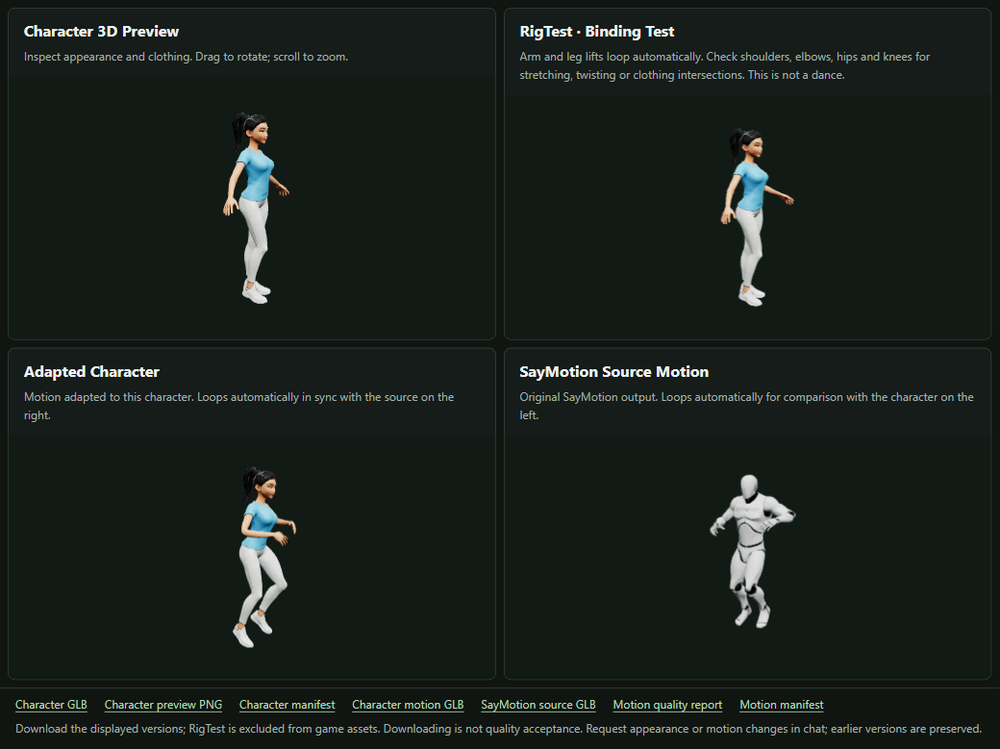
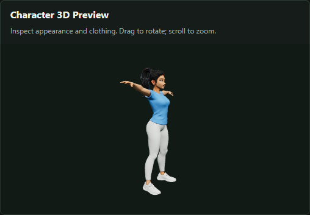
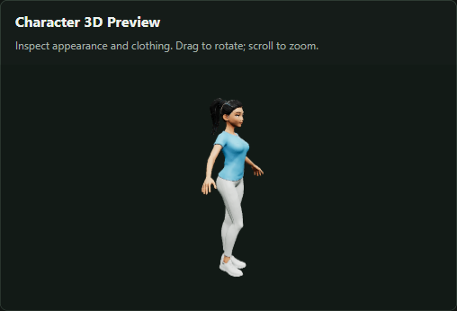
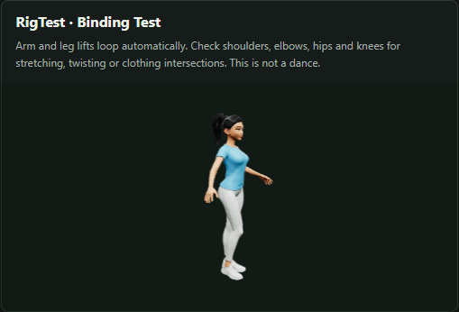
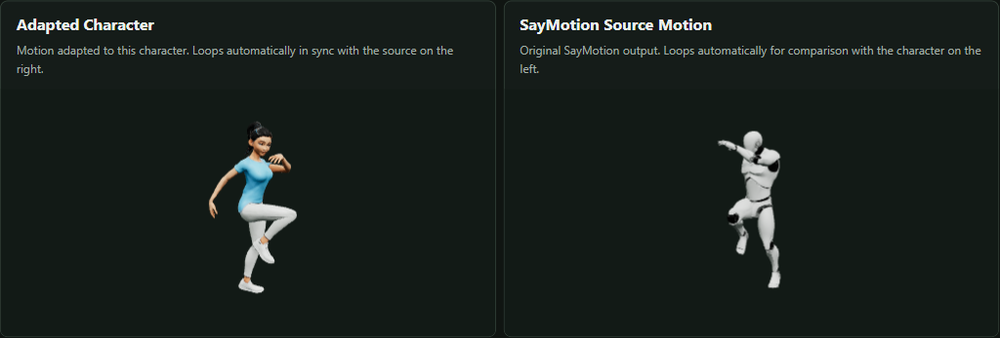

# From One Prompt to an Aerobics Character: A Real CastSmith Session

> **User feedback: "This example worked very well."**
>
> A real chat-driven production session: describe a character and action,
> authorize paid operations, revise the appearance, inspect binding, then
> generate motion and deliver the files. All screenshots and video show
> actual local previews, not mockups or simulated data.

**Session date:** October 27, 2026, evening (UTC-07:00). Build records use UTC,
so their date is October 28. Original conversation excerpts are translated
into English. Published screenshots and video were refreshed with English labels;
the generated models, motion and build IDs are unchanged.

[Watch the MP4 on GitHub Pages](https://samguan2020.github.io/castsmith-agent/) ·
[Production conversation](./conversation.md) · [Character iteration](#character-iteration) ·
[Binding and motion](#binding-and-motion) · [Quality and limitations](#quality-and-limitations) ·
[Reopen in the original workspace](#reopen-in-the-original-workspace)

## Final UI



The image above is a **static screenshot**. For remote playback, open the
[GitHub Pages showcase](https://samguan2020.github.io/castsmith-agent/), which
embeds a [downloadable MP4](./media/castsmith-aerobics.mp4) without requiring
a local service. The video is 16.2 seconds, 1280 × 960, 30 fps, H.264 / yuv420p,
silent, and optimized for progressive playback.

The recording reads the four actual model-preview canvases, arranges them in
four panels and adds English titles. It captures no desktop or chat window.
It contains approximately two eight-second cycles, not necessarily starting
at motion time zero. The original interactive UI still supports model rotation,
zoom and automatic animation looping.

| UI area | What it shows |
|---|---|
| Character 3D Preview | The second character's appearance and clothing; drag to rotate, scroll to zoom |
| RigTest · Binding Test | Free local arm and leg lifts for joint-deformation inspection; not aerobics |
| Adapted Character | The eight-second aerobics animation adapted to the selected character |
| SayMotion Source Motion | Source motion synchronized with the adapted result for comparison |
| Game asset downloads | Character GLB, preview PNG, character manifest, adapted motion GLB, source GLB, quality report and motion manifest |

Generation, paid authorization and review take place in chat. The preview UI
has no generation, selection or playback-control buttons.

## From brief to delivery

The initial user request, translated into English:

> Generate a youthful young woman with a black ponytail, wearing white fitted
> leggings, doing aerobics.

Production explicitly used an **adult woman aged 20-25**. Unspecified details
used defaults disclosed to the user: a semi-realistic 3D style, light blue
athletic top, white sneakers and an eight-second, in-place looping action.

| Stage | What happened | Human decision |
|---|---|---|
| Brief and validation | Save character and aerobics requirements together; create a character-only draft | Authorize Tripo character generation |
| First character | Generate appearance and open the exact preview | Request a slimmer figure and a more beautiful face |
| Second character | Create a candidate linked to the original; preserve the first version | Separately authorize the second Tripo generation, then accept its appearance |
| Free binding test | Select the second character, run local RigTest and verify visible playback | Accept disclosed binding risks and authorize the saved SayMotion request |
| Aerobics and delivery | Generate source motion, adapt it, check structure, open comparison and copy files with hash checks | Later report that the example worked very well |

The session produced **two character candidates, one binding test and one
creative motion**. MCP wait timeouts did not trigger duplicate paid submissions;
the existing build's actual state was checked first.

## Character iteration

| First version | Second version |
|---|---|
|  |  |
| Initial appearance for user inspection | Revised figure and facial features, preserving the outfit and black ponytail brief |

These are real previews of the respective builds. Camera angles can differ;
this is not a matched-angle body measurement or automated beauty assessment.
The user decides whether the appearance is satisfactory.

**Second character brief**

- An adult young woman with a healthy, slender athletic figure and natural proportions.
- A soft oval face, refined features, almond-shaped eyes and a subtle smile.
- A black high ponytail and light blue short-sleeved athletic top.
- Opaque white fitted athletic leggings and white sneakers.
- A semi-realistic 3D style and a neutral pose suitable for rigging.

## Binding and motion

### Free local binding test



The test ran automatically after the user accepted the second appearance.
Recorded playback evidence: RigTest had `data-state="ready"`, and `data-time`
advanced from approximately **3.98 to 5.18 seconds**. This proves that the exact
test loaded and played, not that every joint or skin weight is correct.

### Synchronized aerobics and source comparison



The saved and authorized motion specification:

| Field | Value |
|---|---|
| Name | `aerobics` |
| Duration | 8 seconds |
| Loop | Yes; machine warnings remain at the seam |
| Description | In-place side steps with arm swings, followed by alternating knee lifts and upward reaches, facing forward and returning to the starting stance |
| Providers | SayMotion for motion; Tripo for character appearance |
| Outputs | Adapted character motion GLB, SayMotion source GLB, manifest and quality report |

The description is a **generation target**, not a guarantee of verified motion
semantics. The comparison confirmed both views were `ready`, their times
advanced together and playback crossed the loop boundary. The exported adapted
motion's structural report recorded a duration of **8.0 seconds**.

## Quality and limitations

**Execution success and structural validity do not mean "no quality problems."**
The report remains `needs_review`.

| Check | Result or limitation |
|---|---|
| Character and motion structure | Passed; the motion has 23 bones and lasts 8.0 seconds |
| Delivered file integrity | Copied into a fresh delivery folder; sizes and SHA-256 hashes verified |
| RigTest screening | Possible foot-slide warnings around 4-8 seconds |
| Motion foot-slide screening | Multiple possible-slide warnings; a heuristic is not proof of actual sliding |
| Rotation spikes | Adapted warnings around 3.1-5.8 seconds; a few also occur in the source, with more after adaptation; cause unresolved |
| Skin stretching | Mesh-edge-stretch warnings in the adapted result |
| Loop seam | Velocity-discontinuity warnings at 8 seconds |
| Unchecked | Clothing intersections, motion semantics, true contacts, anatomical limits, skin-weight correctness and game-engine import |

Unchanged reprocessing was not described as repair. No automatic IK foot
locking, collision correction or general skin-weight repair was claimed.
Delivery is not quality acceptance or a certified Unity / Unreal / Godot import.

The user accepted the second appearance and binding result, and authorized the
specified paid motion. At delivery, the motion's engine review was `pending`.
The later successful-workflow feedback is presented honestly.
**Publishing or translating this archive has not changed any asset review state.**

## Exact versions and delivery

| Record | Build ID |
|---|---|
| First character | `build-0a76836facf64f6db191e6936af2b106` |
| Second character, working version | `build-5b37f1acc8314ac7a93c004958011ea0` |
| Second-character RigTest | `build-e4a5fa7169924efb816ed57fa2e22189` |
| Aerobics, clip 0 | `build-6f8df30edd4a45c9a6323b6b1bd8e2be` |

Local delivery folder, relative to the original workspace root:

```text
exports/
  build-6f8df30edd4a45c9a6323b6b1bd8e2be-clip0-zu57ib8l/
    delivery.json
    build-5b37f1acc8314ac7a93c004958011ea0/
      character.glb
      preview.png
      manifest.json
    build-6f8df30edd4a45c9a6323b6b1bd8e2be/
      motion-0.glb
      source-motion-0.glb
      quality-0.json
      manifest.json
```

Original files remain in local `.castsmith/artifacts/<build-id>/`.
Original models, the database, full reports, original delivery files and
credentials **are not published as page assets**. The public page includes
documentation, UI screenshots and a separately recorded demonstration MP4.
Cloning this repository does not provide the original GLBs or local asset database.

## Reopen in the original workspace

The following link works **only on a machine that has these local assets and
a preview service running on port 8767**. It is not a GitHub-hosted interactive viewer:

[Open the exact four-panel local preview](http://127.0.0.1:8767/?character=build-5b37f1acc8314ac7a93c004958011ea0&rig=build-e4a5fa7169924efb816ed57fa2e22189&motion=build-6f8df30edd4a45c9a6323b6b1bd8e2be&clip=0&section=motion)

If needed, run this in the original workspace:

```powershell
.\.venv\Scripts\python.exe .\scripts\studio.py web --port 8767
```

This only starts a preview; it submits no paid generation. If the port is
occupied, do not start a duplicate or terminate an unidentified process.

---

[Production conversation](./conversation.md) · [Project README](../../../README.md)
